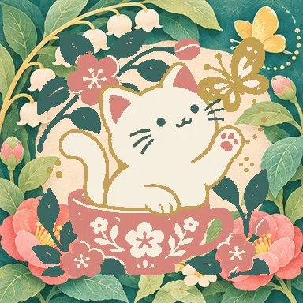
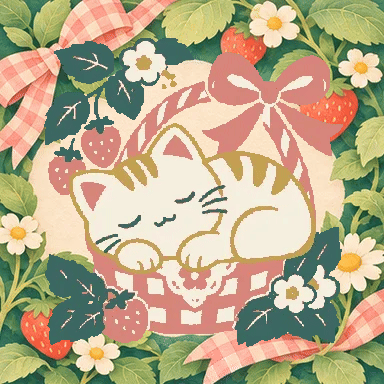

# 完成時の猫アニメーション

153場面それぞれに6枚の描き起こしがあります。前脚・胴体・しっぽ・表情の変化を連続して再生します。頭のメッシュ変形、画像全体の揺れ、CSSによる猫画像の回転は使いません。

- `名前.webp`：384pxの6コマを3列×2行に並べた透過スプライト。各コマの小物は同一です。
- `masks/名前.png`：全コマの猫シルエットの和集合。猫以外の画素が変化しないことの検証に使います。
- `sources/atlas-番号.webp`：背景側の小物、手前の小物、6枚の猫のポーズを分けた制作素材。
- `jobs.json`：制作素材と作品名の対応。
- `catalog.json`：コマ数と制作情報。

背景は `art/finish/` にあり、再生中は固定です。スプライトの色を特色に置き換え、背景と重ねて表示します。`prefers-reduced-motion` では最初のコマを表示します。

小物の配置は `scripts/animation-layouts.json` で調整します。原画で猫の横にある小物は横へ置き、容器がない場面には容器を足しません。猫の前脚が隠れない配置を優先します。

[追加9場面の完成見本](new-scenes.jpg)

| 手を振る | のびとあくび |
| --- | --- |
|  |  |

制作素材から再生成するには、リポジトリ直下で次を実行します。

```sh
node scripts/build-animation.cjs --rebuild
node scripts/build-art.cjs --embed
node tests/animation.cjs
```

新しい生成画像を取り込む場合は、`scenes.json` と `job-番号.json` を置いた作業ディレクトリを `build-animation.cjs` の引数に指定します。1ジョブの画像は4列×4行。前半8セルと後半8セルで、それぞれ1作品を表します。
