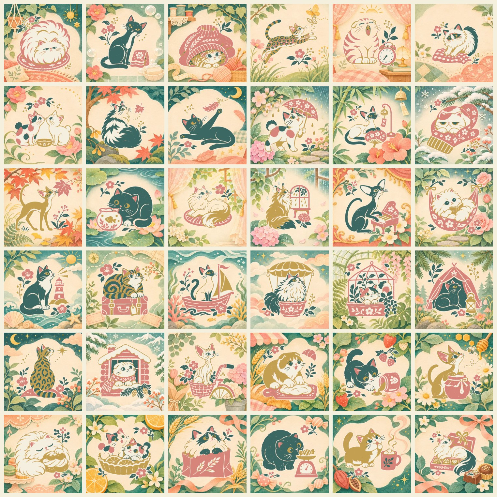

# 追加アート03：しぐさ・四季・旅・おやつ

> 取り込み済み：この36場面は本体に入っています。原画と背景は `art/`・`art/finish/` へ移しました。

36場面の追加素材です。ゲーム本体にはまだ組み込んでいません。

[完成見本の一覧](overview.jpg)

- `core/`：三色＋紙色、512pxの原画
- `finish/`：完成時に加わる384pxの背景
- `complete/`：原画と背景を重ねた512pxの完成見本（取り込み不要）
- `catalog.json`：作品名、猫種、テーマ、姿勢、猫の動く位置

## 内容

| 組 | 場面 | 猫の違い |
|---|---|---|
| しぐさ | 顔洗い、あくび、跳躍、ふみふみ、鼻先合わせなど | 見下ろし、横向き、後ろ姿、2匹組 |
| 四季の暮らし | 春雨、夏風、冬の手ぶくろ、金魚、雨窓など | 折れ耳、短い脚、大きな耳、長毛と短毛 |
| 旅 | 灯台、旅行かばん、帆船、飛行船、温室、テントなど | 猫の体形と場面に合う姿勢 |
| おやつ | パン生地、ジャム、はちみつ、シュー、タルトなど | 前足の使い方、視線、寝姿 |

## 本体への取り込み

1. `core/` のPNGを本体の `art/`、`finish/` のWebPを `art/finish/` へコピーする。
2. このcatalogの項目を、本体の `art/catalog.json` に追加する。
3. 猫の頭の位置を見て `motion` を確認・調整する。
4. `node scripts/build-art.cjs --embed` を実行する。
5. 作品数を固定で確認するテストは、実際に取り込んだ数へ更新する。

パズルでは三色の猫・小物が全部見え、完成すると周囲が豊かになる構成です。完成後も同じ原画を使います。中央を隠す処理や、背景全体を動かす処理は入れません。猫の動きの中心は原画からの初期値なので、組み込み時に確認してください。耳・しっぽ・小物まで収まるよう、余白を確認して6点を描き直しています。

## 作品一覧

| 番号 | 作品 | 猫種・模様 | ファイル |
|---|---|---|---|
| 1 | まあるい寝床 | ペルシャ | `persian-circle` |
| 2 | 顔を洗う朝 | ロシアンブルー | `russian-wash` |
| 3 | 袖のかくれんぼ | マンチカン | `munchkin-sleeve` |
| 4 | 蝶までひと跳び | ベンガル | `bengal-leap` |
| 5 | まだ眠たい | スコティッシュフォールド | `fold-alarm` |
| 6 | ふみふみ毛布 | ラグドール | `ragdoll-knead` |
| 7 | はじめましての鼻先 | ジャパニーズボブテイル | `bobtail-noses` |
| 8 | 落ち葉の気配 | ノルウェージャンフォレストキャット | `norwegian-leaf` |
| 9 | 羽根にとどけ | ボンベイ | `bombay-feather` |
| 10 | 春雨の帰り道 | ジャパニーズボブテイル・三毛 | `calico-rain` |
| 11 | 夏風とシャム | シャム | `siamese-fan` |
| 12 | 手ぶくろの寝床 | エキゾチックショートヘア | `exotic-mitten` |
| 13 | 秋のにおい | アビシニアン | `abyssinian-maple` |
| 14 | 金魚とにらめっこ | ブリティッシュショートヘア | `british-goldfish` |
| 15 | ひだまりの長いしっぽ | ターキッシュアンゴラ | `angora-sunrug` |
| 16 | 雨を数える窓 | メインクーン | `maine-rainwindow` |
| 17 | 小さな演奏会 | オリエンタルショートヘア | `oriental-piano` |
| 18 | ハンモックの読書 | ペルシャ | `persian-hammock` |
| 19 | 灯台の見張り番 | ミックス・ハチワレ | `tuxedo-lighthouse` |
| 20 | 旅じたくは任せて | アメリカンショートヘア | `american-suitcase` |
| 21 | 潮風のセーラー | シャム | `siamese-sailboat` |
| 22 | 雲より高く | ノルウェージャンフォレストキャット | `norwegian-airship` |
| 23 | 温室のひみつ | ジャパニーズボブテイル・三毛 | `calico-greenhouse` |
| 24 | テントでひと休み | ロシアンブルー | `russian-camp` |
| 25 | 星を見上げる背中 | ベンガル | `bengal-stargaze` |
| 26 | 雪小屋の窓 | スコティッシュフォールド | `fold-snowcabin` |
| 27 | 花かごの自転車 | スフィンクス | `sphynx-bicycle` |
| 28 | パン職人の手つき | スコティッシュフォールド | `fold-dough` |
| 29 | ジャムの足あと | ミックス・ハチワレ | `tuxedo-jam` |
| 30 | はちみつの番人 | アビシニアン | `abyssinian-honey` |
| 31 | シューのおふとん | ペルシャ | `persian-creampuff` |
| 32 | 柑橘タルトのふたり | ジャパニーズボブテイル・三毛 | `bobtail-citrus` |
| 33 | パン袋の中から | ラグドール | `ragdoll-breadbag` |
| 34 | お菓子屋のはかり | ブリティッシュショートヘア | `british-sweetscale` |
| 35 | ココアと毛づくろい | マンチカン | `munchkin-cocoa` |
| 36 | チョコ箱の特等席 | ターキッシュアンゴラ | `angora-chocolate` |
