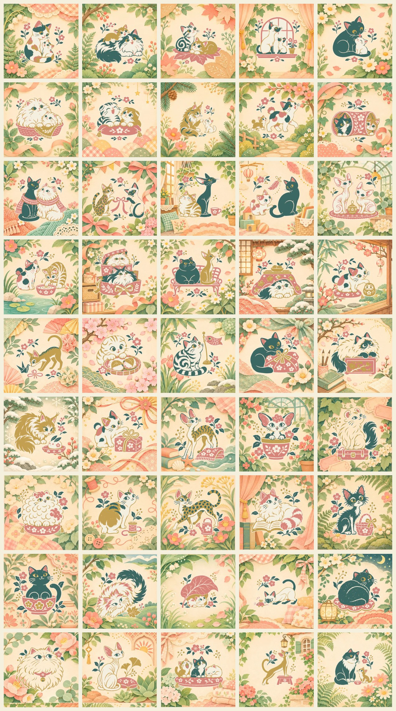

# 追加アート04：親子・猫の会話・和の景色・猫種・構図

45場面の追加素材です。ゲーム本体にはまだ組み込んでいません。

[完成見本の一覧](overview.jpg)

- `core/`：512px、三色＋紙色の原画
- `finish/`：384px、完成時に加える背景
- `complete/`：512px、原画と背景を重ねた完成見本。取り込み不要
- `catalog.json`：作品名・猫種・姿勢・動きの中心

## 今回増やしたもの

親子ときょうだい、2匹のやりとり、和の小物、猫種ごとの耳・毛・しっぽの違い、体の大きさや向きが異なる構図を増やしています。コーニッシュレックス、デボンレックス、アメリカンカール、セルカークレックス、マンクス、オシキャット、ターキッシュヴァン、ライコイ、バーミーズを追加しました。

## Claude向けの取り込み手順

1. `core/` のPNGを本体の `art/`、`finish/` のWebPを `art/finish/` へコピーする。
2. このcatalogの項目を本体の `art/catalog.json` に追加する。
3. `motion` を猫の頭の位置に合わせる。複数の猫がいる絵は、主に動かす猫を決める。
4. `node scripts/build-art.cjs --embed` を実行する。
5. 作品数に依存する検証は、実際に取り込んだ数へ更新する。

パズル中も猫や小物が全部見え、完成時に同じ猫の周囲が豊かになる構成です。中央を隠したり、背景全体を動かしたりしません。動きの中心は素材上の初期値なので、取り込み時に確認してください。`motionTargets` は複数の猫の頭の位置です。現行の `motion` を主対象として残し、複数の猫を動かす際の参考にしています。

## 作品一覧

| 番号 | 作品 | 猫種・模様 | ファイル |
|---|---|---|---|
| 1 | しっぽの中の子猫 | ジャパニーズボブテイル・三毛 | `calico-tailnest` |
| 2 | お母さんの肩まで | ノルウェージャンフォレストキャットと子猫 | `norwegian-kittenclimb` |
| 3 | 葉っぱのきょうだい | アメリカンショートヘア | `american-leafsiblings` |
| 4 | シャム親子の窓辺 | シャム | `siamese-windowfamily` |
| 5 | 毛づくろいの時間 | ボンベイと白い子猫 | `bombay-grooming` |
| 6 | ふたりのかご | ペルシャ | `persian-cuddle` |
| 7 | あくびのとなり | スコティッシュフォールド | `fold-siblings` |
| 8 | 大きな手、小さな手 | メインクーンと子猫 | `maine-pawtouch` |
| 9 | いっしょに歩こう | ジャパニーズボブテイル | `bobtail-follow` |
| 10 | トンネルの向こう | ハチワレと茶トラ | `tuxedo-tunnel` |
| 11 | マフラーを半分こ | ロシアンブルーとターキッシュアンゴラ | `russian-angora-scarf` |
| 12 | リボンの端と端 | オシキャットとシャム | `ocicat-siamese-ribbon` |
| 13 | 背中合わせの昼寝 | マンチカンとオリエンタルショートヘア | `munchkin-oriental-back` |
| 14 | しっぽにちょん | ぶち猫とボンベイ | `patch-bombay-tail` |
| 15 | 大きな耳の相談 | スフィンクス | `sphynx-listening` |
| 16 | 水面のひとしずく | 三毛と茶トラ | `calico-tabby-water` |
| 17 | 箱の上と下 | ペルシャとノルウェージャンフォレストキャット | `persian-norwegian-boxes` |
| 18 | ベンチのふたり | ブリティッシュショートヘアとアビシニアン | `british-abyssinian-bench` |
| 19 | こたつの特等席 | ペルシャ | `persian-kotatsu` |
| 20 | だるまにごあいさつ | ジャパニーズボブテイル・三毛 | `calico-daruma` |
| 21 | 折り鶴を見つけた | アビシニアン | `abyssinian-origami` |
| 22 | 桜もちの香り | スコティッシュフォールド | `fold-sakuramochi` |
| 23 | こいのぼりを見上げて | アメリカンショートヘア | `american-koinobori` |
| 24 | 風呂敷のおふとん | ボンベイ | `bombay-furoshiki` |
| 25 | 文箱のひみつ | ラグドール | `ragdoll-writingbox` |
| 26 | 雪うさぎのとなり | メインクーン | `maine-snowrabbit` |
| 27 | 水引に夢中 | ジャパニーズボブテイル・三毛 | `calico-mizuhiki` |
| 28 | 波模様のコーニッシュ | コーニッシュレックス | `cornish-waves` |
| 29 | デボンの植木鉢 | デボンレックス | `devon-planter` |
| 30 | カールの旅かばん | アメリカンカール | `american-curl-trunk` |
| 31 | くるくるセルカーク | セルカークレックス | `selkirk-cloud` |
| 32 | しっぽのないマンクス | マンクス | `manx-spool` |
| 33 | オシキャットのおさんぽ | オシキャット | `ocicat-watering` |
| 34 | ヴァンの読書 | ターキッシュヴァン | `van-book` |
| 35 | ライコイの小さなかご | ライコイ | `lykoi-basket` |
| 36 | バーミーズと陶器 | バーミーズ | `burmese-bowl` |
| 37 | ななめにのびのび | ノルウェージャンフォレストキャット | `norwegian-diagonal` |
| 38 | 大きな葉っぱの下 | マンチカン | `munchkin-bigleaf` |
| 39 | おもちゃを追う低い姿勢 | シャム | `siamese-lowstalk` |
| 40 | 香箱から振り向いて | ブリティッシュショートヘア | `british-rearloaf` |
| 41 | ふわふわの肖像 | ペルシャ | `persian-portrait` |
| 42 | 肩越しのまなざし | スフィンクス | `sphynx-lookback` |
| 43 | 三匹三様 | 茶トラ・ハチワレ・白猫 | `kitten-trio` |
| 44 | 背伸びのアビシニアン | アビシニアン | `abyssinian-tallstretch` |
| 45 | 大きな先輩、小さな後輩 | ハチワレと茶トラの子猫 | `tuxedo-mentor` |
